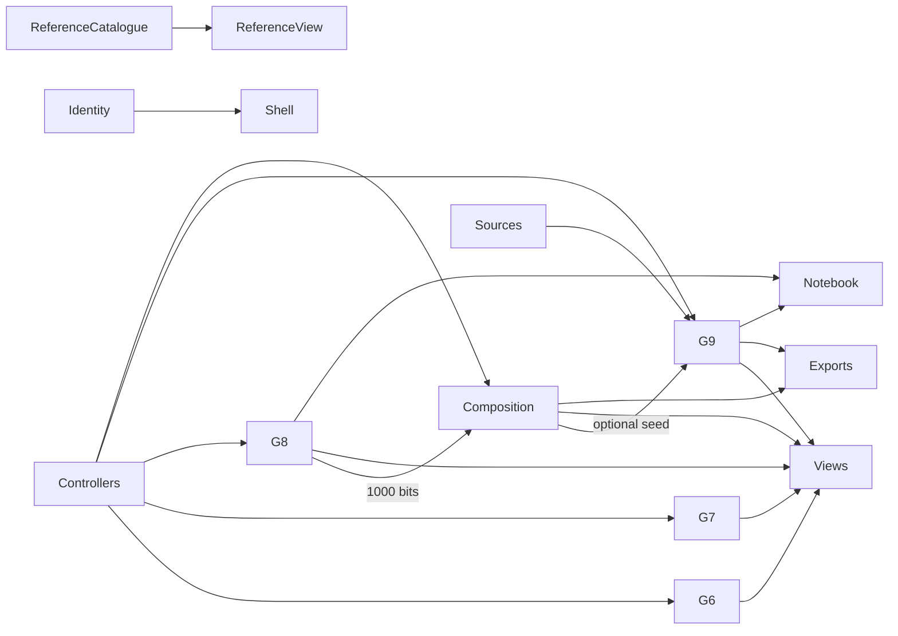

# Modular workflow and composable binary systems

## Purpose and architectural reference

The website is a system of processing modules, rather than a collection of unrelated panels. Each module declares input and output ports, and an edge defines how output becomes another module's input.

The standing starting reference was SEBoK v2.14, System Architecture Design Definition and Logical Architecture (printed pp. 557–558 and 575). Those sections distinguish input/output transformations, functional interactions and allocated logical elements. Applying those ideas to an executable browser signal graph is this project's design choice; SEBoK does not prescribe this JavaScript implementation.

## Two levels of composition

1. Algorithm composition: a binary plant, sensor, PID, bit actuator, oscillator, logistic map, binary diffusion and elementary rule. Its configuration lives in `src/algorithms/composition.ts`.
2. Website composition: controller menu, source editors, G6/G7/G8/G9/G10 modules, views, metrics, evidence exporter, notebook, reference catalogue and identity shell. Its contracts live in `src/flow/runtime.ts` and adapters in `src/flow/site.ts`.

## Signal and scheduling contracts

- Port kinds are command, snapshot, binary, source, evidence and annotation.
- Payloads are cloned across each edge. Binary payloads must contain exactly 1000 characters from 0/1; source signals need source text; command signals need a target. Non-finite and unserializable data are rejected.
- Model views accept snapshots tagged with their owning module. The legacy G6/G7/G8 views still read their module-owned view state internally; the workflow schedules their rendering without rewriting their established numerical engines.
- Immediate edges drain through a bounded queue. Synchronous cycles are rejected. Delayed edges enqueue a copy for the next explicit workflow tick.
- A G9 source request is a synchronous read through an enabled immediate source edge. Delayed source wiring does not satisfy this request and is reported as an error.
- The graph supports at most 128 edges, 512 queued/delivered messages per drain, a 4 MB signal bound and a 160-entry trace. These are prototype limits.
- Disabling an edge cancels queued messages on that edge. Consumers retain their last rendered/cached state. Reconnection takes effect on the next output event.
- Wiring import validates all edges before replacing the current graph. Save/load uses browser local storage; JSON export/import makes the wiring portable. Layout and delivery counters are not persisted as model state.

## PID implementation and binary actuation

The controlled variable is ON-bit density, not a domain-specific physical quantity. One model time step is dt=1 by default. P, I and derivative registers are quantized to signed Q16.16 words; cells remain one-bit values. The derivative is a filtered derivative on measurement to avoid a setpoint kick. Conditional integration freezes the accumulator when saturation and error push in the same direction. Output is bounded to ±0.128 density, at most 128 bit changes per tick under the default limit.

The actuator uses a seeded permutation and commits a deterministic number of eligible bit changes. A small plant loss supplies a disturbance. Disabling the PID→actuator link gives an otherwise matched open-loop baseline. Comparisons measure population error and Hamming difference; they do not claim universal improvement, physical-system stability or scientific emergence.

A matched experiment starts from the same initial bits, drivers, seed and horizon. Replay verifies the full binary and numerical trajectories. A received G8 binary snapshot can seed composition; G9 uses received composition bits only when its explicit workflow-seed checkbox is selected.

## Additional simple equations

- Oscillator: θ(t+1)=θ(t)+0.17·dt; sine modulates the target by ±100 bits.
- Logistic map: x(t+1)=r·x(t)·(1−x(t)), r=3.7 by default; its output modulates the target by ±60 bits.
- Diffusion adaptation: threshold a weighted mixture of the current bit (0.55) and its six periodic face neighbors (0.45). This is a binary neighborhood rule, not a continuous PDE solver.
- Elementary rule 90: x-axis Boolean updates using the same rule-table convention as G8.

References: [Åström and Murray, PID implementation](https://www.cds.caltech.edu/~murray/books/AM05/pdf/am08-pid_19Jul11.pdf), [Kaneko and Yanagita, Coupled maps](https://www.scholarpedia.org/article/Coupled_maps).

## Logo resource

The refined preview is stored at `public/resources/atunbi-logo.png` and deployed through AppDeploy's resource upload path. Identity configuration publishes its path to the website shell. The supplied source images are not embedded as base64 or modified in place.

## Verification and future boundaries

The tests cover convergence on the defined plant, saturation/anti-windup, filtered derivatives, binary invariants, exact paired replay, invalid contracts, atomic wiring imports, edge disconnection and delayed delivery, plus existing lab and controller workflows. The browser suite includes automated accessibility checks and a simulated WebXR session; physical headset tracking, device behavior and comfort remain unverified.

As modules grow, revisit worker-based execution, finer-grained snapshot schemas, delivery backpressure, disposal/unsubscription, and replacing remaining legacy DOM-control adapters with model-level command handlers. This version provides executable module boundaries without claiming that every legacy implementation detail has been refactored.
