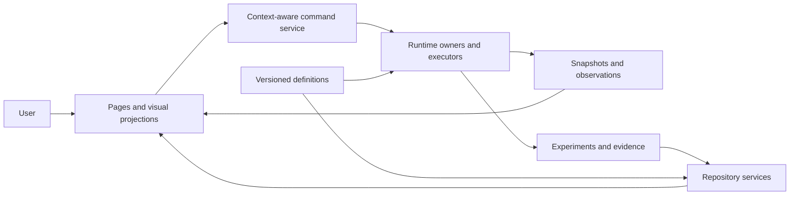

# SG04 — functional boundaries and ownership

Decision ADR-001: preserve a modular browser application with explicit service boundaries. Do not make one server or database per page. A hosted/local backend is an SG08 decision; this change introduces neither. Alternatives considered: keep all logic inside page modules (low migration effort, prevents headless use), rewrite all engines into one semantics (breaks scientific distinctions), extract existing domain kernels and progressively isolate orchestration (selected; preserves behavior while making ownership testable).

This is the target boundary map. Command, identity and repository extraction remain incomplete; the arrows do not claim those services already exist.

| Function | Authoritative state owner | Explicit inputs → outputs | Current implementation / next migration |
|---|---|---|---|
| Author/validate rules | algorithm registry, currently workshop draft + library | draft/truth table → validated definition | library pure; draft/storage/UI separation needed |
| Compile G7 | pure parseSource | structured source → immutable-by-convention Program or diagnostic | src/engines/g7.ts extracted; page owns editable text |
| Execute G7 | one BinaryMachine instance | Program + step/run → units, registers, packets, tick | src/engines/g7.ts; no DOM or timer |
| Compile G8 | pure compile | binary language source → Program or diagnostic | src/engines/g8.ts extracted |
| Execute G8 | one VM instance | Program + coupling/step → matrices, queues, trace, tick | src/engines/g8.ts; pages own playback timer only |
| Compose/execute tools | GraphEngine instance; builder owns draft | validated graph + exposed values → Frame | pure engine exists; draft history and service extraction needed |
| Execute G6 | G6Workspace instance | environments/layers/edges + tick → fields and registers | src/engines/g6.ts now owns state, numerical step/reset, snapshot and atomic restore; visual editing wrappers remain |
| Control | CompositionEngine | config + seed + step → bits, PID memory, trajectory | pure; orchestration/input draft extraction needed |
| Combine algorithms | library engine instance | definitions/config + tick → registers/projections | pure; registry identity/version integration needed |
| Compare | analyze / runAblationExperiment / compareComposition | frozen state + intervention → matched outputs | domain functions exist; evidence ownership/IDs needed |
| Observe | source engine owns model; view owns camera/slice | snapshots + selection → projection | projections must not mutate model; common observation context pending |
| Annotate | HypothesisNotebook service | validated claim/status + pattern/source/config → detached record | src/services/hypotheses.ts; injected storage, bounded retention, explicit session-only failure and recovery export |
| Persist | repository service | expected revision + document → stored revision/error | builder injected Store exists; other UI storage to migrate |
| Share/export | evidence producer + file adapter | identified immutable bundle → portable file | current download path uses flow; schema/identity pending |
| Website routing | FlowRuntime | configured edges + signal → receipts/queued messages | distinct clock; semantic contracts and consumption receipts pending |
| Navigate | context service, currently page router | route/entity selection → visible page/context | page visibility works; common entity ownership pending |

## Dependency and state rules

Domain modules must not import DOM, styles, browser storage, timers or the site router. Presentation may import domains; domain functions cannot click presentation controls. Each runtime instance owns its scientific state; observers receive copies/projections. Draft changes, applied configuration, playback state and frozen evidence are distinct owners. Definitions will become versioned immutable records under SG05/12; extraction alone does not establish that guarantee.

Page allocation: network/layers/relationships/spatial/metrics/experiments are coordinated views over G6. Compiler and binary expose distinct G7/G8 domains. PID/ecology/discovery/builder each retain their declared execution. Workshop supplies supported definitions. Wiring/features/Home inspect the same website routing registry. Controllers issue commands. References/theory select supporting information without forcing simulation mutation.

## Extraction verification

Compare full serialized VM states at 0, 1, 8 and 24 ticks, across all baseline presets and both coupled/uncoupled modes, against fixtures generated from baseline commit ed6f954. Pure module imports are exercised without document/window. Existing grammar, packet, coordinate and malformed-source checks remain. Browser regression verifies page controls still invoke the same engines.

SG04 remains in progress until the remaining authoring, annotation, orchestration and persistence ownership are independently exercisable. G6 has a headless workspace owner; remaining edit commands still need the shared command boundary. This document is not evidence that all modules meet that gate.

## G6 extraction

The editor now refers to one G6Workspace for nodes, edges, tick, identifiers and installed custom definitions. Rendering, active selection, drag gestures and playback timing remain view state. Numerical transitions, initial fields, staged updates, reset, export and full validation/restore are in src/engines/g6.ts. No kernel imports Three.js or the document. A snapshot is detached from its source; restore validates a staged network before replacing state.

Baseline fixtures cover all four legacy algorithms, twelve library algorithms and the linked example at ticks 0, 1, 8 and 24. This preserves existing clipped/periodic topology distinctions and numeric-register semantics. Negative tests cover malformed fields and edges, foreign environment ownership, capacity limits, failed-tick atomicity and invalid algorithm creation. Numeric continuation is tested after restore; this is the existing G6 network format, not a universal cross-engine checkpoint claim.

## Observer notebook boundary

HypothesisNotebook owns observer records independently of UI and scientific execution. The page supplies an injected browser storage adapter; the service validates records and returns persistence outcome. Corrupt/unreadable storage is preserved without automatic replacement. A storage-write failure retains the hypothesis in session memory and the UI states that it is not durable. Recovery export includes the original captured data and current session records. Existing valid atunbi.g9.notes records retain their format. This is recovery preservation, not yet the full versioned project/evidence repository required by SG05/23.
